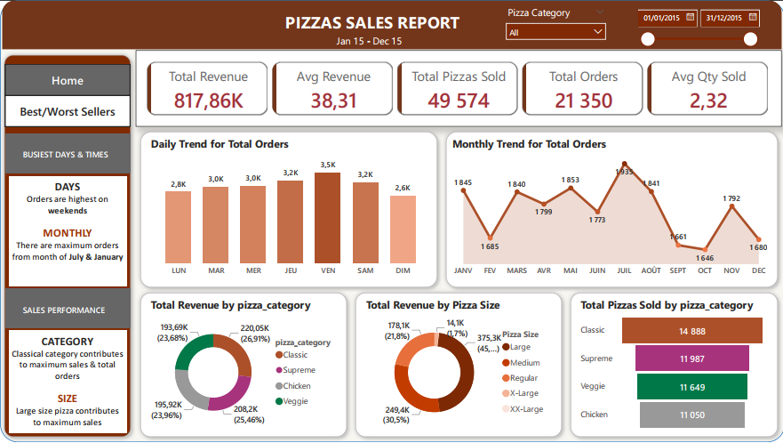
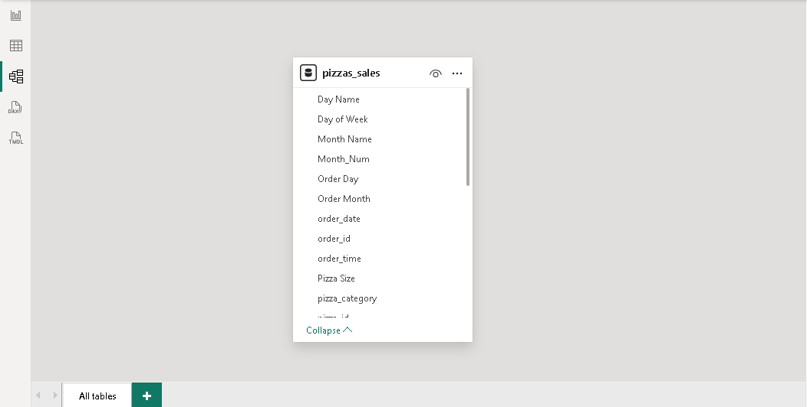
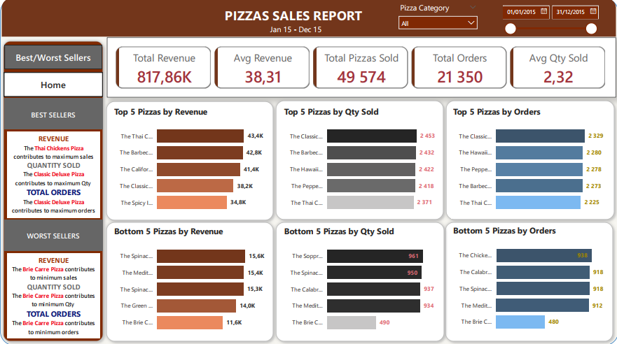

# Analyse Commerciale et Financière des Ventes de Pizzas — SQL Server & Power BI

### Chiffre d'affaires, panier moyen, saisonnalité, mix produit (catégories et tailles) et palmarès des ventes

**Auteur :** Brice Abogo  
**Spécialisation :** Analyse financière | Comptabilité | Business Intelligence  
**Technologies :** MS SQL Server (T-SQL) | Power Query (M) | DAX | Power BI Desktop | Power BI Service | Passerelle de données locale



---

## 1. Présentation du projet

Ce projet présente une solution complète de Business Intelligence appliquée au suivi commercial et financier d'une activité de restauration (vente de pizzas) sur l'ensemble de l'exercice 2015. 

À partir d'un fichier plat CSV de 48 620 lignes de commandes, les données sont d'abord chargées et auditées dans **Microsoft SQL Server** afin de calculer et certifier l'ensemble des indicateurs de référence en T-SQL. Elles sont ensuite transformées dans **Power Query**, exploitées par des mesures **DAX** dans un rapport **Power BI Desktop** de deux pages, puis publiées sur **Power BI Service** avec une actualisation automatisée via une passerelle locale.

Le rapport permet de :

- piloter les 5 indicateurs clés de performance : chiffre d'affaires, panier moyen, volume de pizzas vendues, nombre de commandes et quantité moyenne par commande ;
- identifier les pics d'activité journaliers et mensuels pour optimiser la planification opérationnelle ;
- analyser la contribution au chiffre d'affaires et aux volumes par catégorie et par taille de pizza ;
- isoler les 5 produits les plus performants (*Best Sellers*) et les 5 moins performants (*Worst Sellers*) selon trois axes : chiffre d'affaires, quantité et nombre de commandes.

---

## 2. Questions analysées

1. Quels sont le chiffre d'affaires annuel, le panier moyen et le volume moyen d'articles par commande ?
2. Quels jours de la semaine et quels mois de l'année concentrent le plus grand nombre de commandes ?
3. Quelles catégories et quelles tailles de pizzas génèrent l'essentiel du chiffre d'affaires ?
4. Quelles références composent le Top 5 et le Bottom 5 en valeur, en volume et en fréquence de commande ?

---

## 3. Outils et technologies

| Technologie | Usage |
|---|---|
| Microsoft SQL Server (T-SQL) | Typage des données, contrôle qualité et requêtes de réconciliation des indicateurs |
| Power Query (M) | Connexion SQL, normalisation des tailles et enrichissement calendaire (`fr-FR`) |
| Power BI Desktop | Modélisation et conception du tableau de bord interactif |
| DAX | Agrégations monétaires, volumétriques et calcul sécurisé des ratios (KPIs) |
| Power BI Service | Publication et partage sécurisé du rapport |
| Passerelle de données locale (mode standard) | Connexion au serveur local et actualisation planifiée biquotidienne |
| GitHub | Documentation technique, versionnement des scripts et portfolio |

---

## 4. Données

| Fichier | Contenu | Lignes | Colonnes |
|---|---|---:|---:|
| `data/pizza_sales.csv` | Historique détaillé des lignes de commandes de pizzas | 48 620 | 12 |

- **Période :** du 1ᵉʳ janvier 2015 au 31 décembre 2015.
- **Volume :** 48 620 lignes de vente correspondant à **21 350 commandes uniques** et **49 574 pizzas vendues**.
- **Origine :** source publique en ligne, non identifiée avec certitude. Licence d'origine non confirmée.
- **Usage :** pédagogique et démonstratif.

> La licence MIT s'applique aux scripts (SQL, M, DAX) et à la documentation, **pas au fichier de données**. Détails dans [`data/README.md`](data/README.md).

---

## 5. Préparation et validation des données

Les scripts SQL et Power Query, commentés et structurés, sont disponibles dans [`sql/`](sql/) et [`power-query/`](power-query/).

| Étape | Outil | Détail du traitement |
|---|---|---|
| Typage monétaire | MS SQL Server | Conversion explicite de `unit_price` et `total_price` en `DECIMAL(10,2) NOT NULL` |
| Audit et réconciliation | MS SQL Server | Requêtes T-SQL validant les 5 KPIs, les tendances et les classements Top/Bottom 5 avant visualisation |
| Normalisation des tailles | Power Query | Transcodification des codes (`S`, `M`, `L`, `XL`, `XXL`) en libellés explicites (`Regular`, `Medium`, `Large`, `X-Large`, `XX-Large`) |
| Enrichissement temporel | Power Query | Extraction des noms de jours et de mois avec culture explicite `fr-FR` et début de semaine fixé au lundi (`Day.Monday`) |
| Abréviations calendaires | Power Query | Normalisation des mois courts (`JANV`, `FEV`, `MARS`, `AVR`, etc.) pour un affichage homogène sur les axes graphiques |

---

## 6. Modèle de données

Le modèle repose sur la table analytique `pizzas_sales`, directement alimentée par la base SQL Server après enrichissement dans Power Query.



Détails méthodologiques et pistes d'évolution en schéma en étoile dans [`documentation/limites-et-avertissements.md`](documentation/limites-et-avertissements.md).

---

## 7. Mesures DAX

L'ensemble des formules est documenté dans [`dax/mesures-dax.dax`](dax/mesures-dax.dax).

| Famille | Mesure | Formule / Logique |
|---|---|---|
| **Mesures de base** | `Total Revenue` | `SUM(pizzas_sales[total_price])` |
| **Mesures de base** | `Total Orders` | `DISTINCTCOUNT(pizzas_sales[order_id])` |
| **Mesures de base** | `Total Pizzas Sold` | `SUM(pizzas_sales[quantity])` |
| **Ratios & KPIs** | `Avg Revenue` | `DIVIDE([Total Revenue], [Total Orders], BLANK())` |
| **Ratios & KPIs** | `Avg Qty Sold` | `DIVIDE([Total Pizzas Sold], [Total Orders], BLANK())` |
| **Analyse de part (%)** | `Revenue Share %` | Part du chiffre d'affaires sur le périmètre sélectionné (`ALLSELECTED`) |

Points de conception :

- distinction stricte entre les mesures d'agrégation de base et les ratios composés ;
- utilisation systématique de `DIVIDE()` au lieu de l'opérateur `/` pour prévenir les erreurs de division par zéro ;
- utilisation de `DISTINCTCOUNT(order_id)` pour comptabiliser chaque commande une seule fois, quel que soit le nombre de pizzas qu'elle comporte.

---

## 8. Pages du rapport

### Page 1 — Home (Vue d'ensemble et saisonnalité)

Synthèse des 5 KPIs majeurs, synthèse analytique latérale (*Busiest Days & Times* et *Sales Performance*), évolution journalière et mensuelle des commandes, répartition du chiffre d'affaires par catégorie et par taille, et volume vendu par catégorie.


### Page 2 — Best/Worst Sellers (Palmarès des produits)

Rappel des 5 KPIs, synthèse des meilleures et moins bonnes références, et six graphiques comparant le **Top 5** et le **Bottom 5** des pizzas selon le chiffre d'affaires (*Revenue*), la quantité vendue (*Qty Sold*) et le nombre de commandes (*Orders*).



**Filtres et navigation :** Boutons de navigation entre les pages (*Home* / *Best/Worst Sellers*), segment par catégorie (`Pizza Category`) et sélecteur de période (`01/01/2015` au `31/12/2015`).

---

## 9. Indicateurs clés (Exercice 2015)

### 9.1. Indicateurs globaux

| Indicateur | Valeur exacte (SQL) | Affichage rapport |
|---|---:|---:|
| **Total Revenue** (Chiffre d'affaires) | 817 860,05 | 817,86K |
| **Avg Revenue** (Panier moyen) | 38,31 | 38,31 |
| **Total Pizzas Sold** (Pizzas vendues) | 49 574 | 49 574 |
| **Total Orders** (Commandes uniques) | 21 350 | 21 350 |
| **Avg Qty Sold** (Pizzas / commande) | 2,32 | 2,32 |

### 9.2. Répartition par catégorie et par taille

| Catégorie | Chiffre d'affaires | Part (%) | Pizzas vendues |
|---|---:|---:|---:|
| **Classic** | 220,05K | 26,91 % | 14 888 |
| **Supreme** | 208,20K | 25,46 % | 11 987 |
| **Chicken** | 195,92K | 23,96 % | 11 050 |
| **Veggie** | 193,69K | 23,68 % | 11 649 |

| Taille | Chiffre d'affaires | Part (%) |
|---|---:|---:|
| **Large (L)** | 375,3K | 45,89 % |
| **Medium (M)** | 249,4K | 30,50 % |
| **Regular (S)** | 178,1K | 21,77 % |
| **X-Large (XL)** | 14,1K | 1,72 % |
| **XX-Large (XXL)** | 1,0K | 0,12 % |

---

## 10. Constats et enseignements métiers (2015)

1. **Pic d'activité en fin de semaine.** Les commandes progressent régulièrement du lundi (2,8K) au **vendredi**, qui constitue le jour le plus chargé de la semaine (**3,5K commandes**), suivi du jeudi et du samedi (3,2K chacun). Le dimanche enregistre le volume le plus faible (2,6K).
2. **Saisonnalité mensuelle marquée en juillet et janvier.** Le pic annuel est atteint en **juillet (1 935 commandes)**, suivi de mai (1 853) et janvier (1 845). Les mois d'octobre (1 646), septembre (1 661) et décembre (1 680) affichent un ralentissement.
3. **Un portefeuille de catégories équilibré, dominé par la gamme *Classic*.** Les quatre catégories contribuent chacune entre 23,7 % et 26,9 % du chiffre d'affaires. La gamme *Classic* domine à la fois en valeur (220,05K, soit 26,91 %) et en volume (14 888 unités).
4. **Forte concentration sur les tailles *Large* et *Medium*.** La taille *Large* génère à elle seule près de la moitié du chiffre d'affaires (**45,89 %, soit 375,3K**) et, combinée à la taille *Medium* (30,5 %), représente plus de **76 % des ventes**. Les formats *X-Large* et *XX-Large* sont marginaux (< 2 %).
5. **Palmarès produits (*Best & Worst Sellers*) :**
   - **En chiffre d'affaires :** *The Thai Chicken Pizza* arrive en tête (**43,4K**), suivie de *The Barbecue Chicken Pizza* (42,8K) et *The California Chicken Pizza* (41,4K).
   - **En volume et commandes :** *The Classic Deluxe Pizza* est la plus vendue en quantité (**2 453 pizzas**) et la plus présente dans les commandes (**2 329 commandes**).
   - **Référence la moins performante :** *The Brie Carre Pizza* se classe dernière sur les trois critères simultanément (**11,6K** de CA, **490 pizzas** vendues et **480 commandes**).

### Recommandations opérationnelles

- **Rationalisation de la carte :** Évaluer le maintien ou la reformulation de *The Brie Carre Pizza* et supprimer la taille *XX-Large* (0,12 % du CA) pour réduire la complexité des stocks.
- **Actions promotionnelles ciblées :** Mettre en place des offres dédiées les lundis et dimanches ainsi qu'aux mois de septembre et octobre pour lisser le taux d'utilisation des cuisines.
- **Politique d'upselling :** Valoriser les menus combinés autour des formats *Medium* et *Large* pour consolider le panier moyen au-dessus de 38,31.

---

## 11. Architecture technique

```text
Fichier CSV source (pizza_sales.csv)
        │
        ▼
MS SQL Server (Base Pizzas : typage DECIMAL, audit et validation T-SQL)
        │
        ▼
Power Query (Connexion SQL, normalisation des tailles, calendrier fr-FR)
        │
        ▼
Modèle et Mesures DAX (Agrégations de base et ratios sécurisés)
        │
        ▼
Rapport Power BI Desktop (2 pages : Home & Best/Worst Sellers)
        │
        ▼
Power BI Service
        │
        ▼
Passerelle de données locale (Mode Standard)
        │
        ▼
Actualisation planifiée : 11 h 30 et 17 h 00 (Heure d'Afrique du Sud — UTC+02:00)
